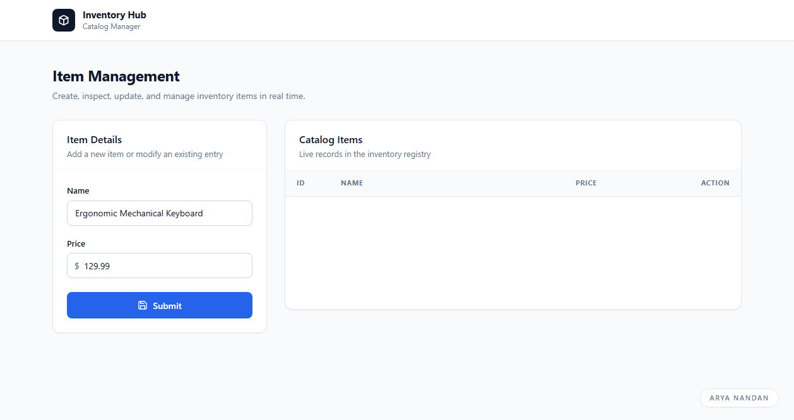
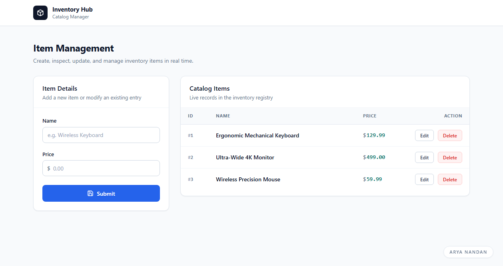
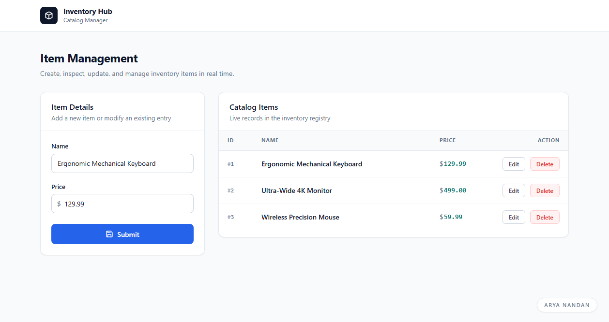
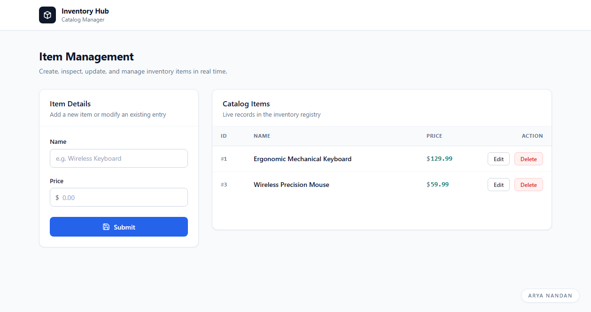

# Inventory Management & Item CRUD Application

A modern, responsive web application for managing catalog inventory with real-time CRUD operations. Built with a clean enterprise-grade interface, semantic HTML, modern CSS design tokens, and a RESTful Express.js backend.

---

## Overview & UI Redesign

The user interface has been completely redesigned with a focus on usability, visual hierarchy, and professional aesthetics:

- **Dashboard Layout**: A balanced two-column dashboard displaying the item entry form on the left and the real-time catalog table on the right.
- **Modern Design System**: Built with carefully chosen slate-neutral tones (`#f8fafc`, `#ffffff`, `#0f172a`, `#334155`, `#e2e8f0`), deep cobalt primary accents (`#2563eb`), and subtle hairline borders with natural shadows.
- **Component Polish**:
  - **Form Controls**: Crisp field labels, integrated currency prefix (`$`), accessible focus rings, and an icon-enhanced primary action button.
  - **Data Table**: Clean header tracking, tabular numbers, monospace identifiers (`#1`), formatted price tags (`$129.99`), and distinct visual treatments for **Edit** and **Delete** actions.
- **Responsive Architecture**: Adapts seamlessly to desktop and tablet viewports, preserving data accessibility across screen sizes.

---

## Tech Stack

- **Frontend**:
  - HTML5 (Semantic Structure)
  - CSS3 (Custom Properties, Flexbox, CSS Grid)
  - JavaScript (ES6+ Fetch API, DOM manipulation)
- **Backend**:
  - Node.js
  - Express.js (REST API, static asset serving)

---

## Project Structure

```
.
├── public/
│   ├── index.html       # Application markup and dashboard layout
│   ├── script.js        # REST API integration and client-side logic
│   └── style.css        # Design tokens, typography, and component styling
├── screenshots/
│   ├── create-item.png  # New item entry form
│   ├── read-items.png   # Populated catalog table
│   ├── update-item.png  # Edit mode state
│   └── delete-item.png  # Catalog view after item removal
├── .gitignore
├── package-lock.json
├── package.json
├── README.md
└── server.js            # Express server and in-memory REST endpoints
```

---

## Installation & Running Locally

### Prerequisites
- [Node.js](https://nodejs.org/) (v16 or newer recommended)
- npm (installed with Node.js)

### Steps

1. **Clone the repository** (or navigate to the project directory):
   ```bash
   cd "TASK1"
   ```

2. **Install dependencies**:
   ```bash
   npm install
   ```

3. **Start the application**:
   ```bash
   npm start
   ```

4. **Open in browser**:
   Navigate to [http://localhost:3000](http://localhost:3000) or [http://127.0.0.1:3000](http://127.0.0.1:3000).

---

## REST API Endpoints

| Method | Endpoint | Description | Request Body |
| :--- | :--- | :--- | :--- |
| `GET` | `/items` | Retrieve all inventory items | None |
| `POST` | `/items` | Add a new item to catalog | `{ "name": "string", "price": number }` |
| `PUT` | `/items/:id` | Update an existing item by ID | `{ "name": "string", "price": number }` |
| `DELETE` | `/items/:id` | Delete an item by ID | None |

---

## Application Walkthrough

### 1. Create Item (Input Form)
Enter the item name and price in the entry form. Submitting triggers a `POST /items` request, immediately adding the record to the catalog and refreshing the list.



### 2. Read Items (Live Catalog Table)
All recorded items are fetched from the server via `GET /items`. Each item displays its unique ID badge, name, price, and dedicated action buttons.



### 3. Update Item (Edit Mode)
Clicking the **Edit** button loads that item's data into the form fields. Submitting the form sends a `PUT /items/:id` request to update the record in place.



### 4. Delete Item
Clicking the **Delete** button sends a `DELETE /items/:id` request to remove the selected item from the database, instantly updating the catalog view.


